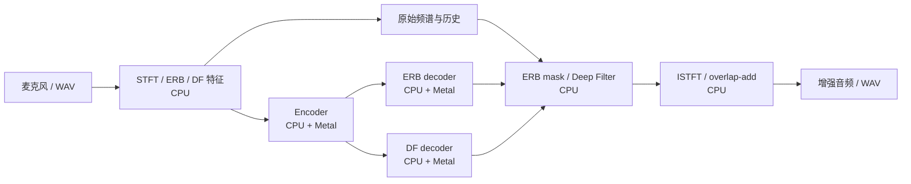

# AI Runtime

一个从零实现的 C++ 推理运行时，包含 Tensor、内存池、计算图、ONNX 子集执行器和 CPU/Metal 后端。当前主要应用是运行 [Hush](https://github.com/pulp-vision/Hush) 语音增强模型，配套 macOS 麦克风 App、音频对比回放和推理过程可视化。

当前 Hush 使用 CPU/Metal 混合执行。模型运行链路已接通；主讲保真和背景人声分离效果仍有局限，详见[能力边界](#能力边界)。

## 从哪里开始

| 目标 | 入口 |
| --- | --- |
| 零基础读懂源码 | [从 0 到 1：8 课源码课程](docs/runtime-from-zero/README.md) |
| 在 Mac 上体验录音与处理效果 | [运行 macOS App](#运行-macos-app) |
| 查看真实推理事件 | [推理回放页面](http://81.71.150.26/) |
| 学习数学公式和 GPU 计算 | [18 节动画教程](http://81.71.150.26/tutorial.html) |
| 了解开发中踩过的坑 | [Runtime 落地复盘](docs/runtime-implementation-retrospective.md) |

## 当前实现

| 模块 | 已有能力 |
| --- | --- |
| 数据与内存 | Float32 Tensor、shape/stride/offset、共享 view、arena 内存池与统计 |
| 计算执行 | 手写 Graph/Executor、CPU 算子、Metal 算子与部分 buffer 复用 |
| 模型加载 | gzip/tar bundle、ONNX 图/权重/属性读取、执行计划与 initializer 缓存 |
| Hush 会话 | 前端特征、三张 ONNX 子图、频谱增强、音频重建、跨帧状态与 reset |
| macOS App | 麦克风采集、手动开始/停止录音、原音/增强对比、双人语音混音演示 |
| 观测与教学 | 有界事件队列、后台 InfluxDB 上传、真实阶段回放、数学动画课程 |
| 验证工具 | 基础回归、Metal 对照、真实模型 probe、内存压力、独立 ONNX Runtime 参考 |

### Hush 怎样处理一段声音

当前模型使用 16 kHz 单声道音频，每帧 160 个采样点，对应 10 ms 音频；分析窗为 320 点。



选择 Metal 后端时，支持的节点交给 GPU，ONNX GRU 和部分形状、广播等计算仍在 CPU。通用 Metal STFT/ISTFT 原语已有实现，但当前完整 Hush 会话使用 CPU 前端与重建路径。

GRU、因果卷积、归一化、Deep Filter 和重建都需要保留历史。会话状态独立于临时内存池保存，`pool.reset()` 用于复用临时空间。

## 运行 macOS App

本机已有构建时，在项目根目录运行：

```sh
open build-app/bin/hush_mic_ui.app
```

App 内置模型和两段演示语音，运行不依赖 Python。`build-app/` 是被 Git 忽略的本机产物；新克隆仓库需要按下一节构建。

### 麦克风录音对比

1. 确认模型已加载，Backend 选择 `Metal`，点击 `Start Microphone`。
2. 首次使用时手动允许麦克风权限；若被拒绝，在「系统设置 → 隐私与安全性 → 麦克风」开启。
3. 点击 `Record A/B Test` 开始录音，再点击 `Stop A/B Recording` 结束，自行控制时长。
4. 等待整段录音处理结束，依次播放 `Play Raw Mic` 和 `Play Hush`。

`Play Raw Mic` 播放转换为 16 kHz 的麦克风采集音频；`Play Hush` 播放同一段音频的增强结果。两者应有相同样本数和播放时长。当前录音保存在内存中，录得越长，占用越多。

### 背景人声演示

选择背景相对主讲的音量，点击 `Generate Background Voice Demo`，完成后对比 `Play Mixed Input` 与 `Play Enhanced Output`。演示可以独立运行，不需要开启麦克风。

默认 `Background −18 dB` 表示背景人声比主讲低 18 dB。该选项只改变输入混音比例，不调整模型参数。素材是两段独立的中文合成语音，来源见 [App 资源说明](apps/resources/README.md)。

播放按钮只播放已生成的文件，不重新推理。输出变小不能单独证明背景人声被选择性消除，需要同时听主讲是否清晰、背景是否残留。

## 从源码构建

主要开发和验证环境为 Apple Silicon macOS。需要支持 C++20 的编译器、CMake 3.20+、macOS SDK 和 zlib；macOS SDK 提供 Metal、Foundation、AVFoundation、AppKit 等框架。Node.js 用于网页测试，Python/ONNX Runtime 仅用于可选的独立参考验收。

以下命令均在项目根目录执行。

### 先运行不需要模型的最小示例

```sh
cmake -S . -B build-app -DCMAKE_BUILD_TYPE=Release -DBUILD_TESTING=ON
cmake --build build-app --parallel 4 --target mini_runtime_demo mini_runtime_tests
./build-app/bin/mini_runtime_demo
ctest --test-dir build-app -R '^mini_runtime_tests$' --output-on-failure
```

该示例执行 `MatMul → Add`，预期结果为 `[32, 48, 79, 104]`。缺少模型时，CMake 会提示 App 未内置模型，不影响这两个入门目标。

### 构建带模型的完整 App 与工具

首次构建时下载当前 Hush bundle；已有该文件可以跳过下载：

```sh
mkdir -p build-app/models
curl --fail --location \
  https://raw.githubusercontent.com/pulp-vision/Hush/main/deployment/models/advanced_dfnet16k_model_best_onnx.tar.gz \
  --output build-app/models/hush-real-model.tar.gz
```

```sh
cmake -S . -B build-app -DCMAKE_BUILD_TYPE=Release -DBUILD_TESTING=ON \
  -DHUSH_MODEL_BUNDLE_PATH="$PWD/build-app/models/hush-real-model.tar.gz"
cmake --build build-app --parallel 4
./build-app/bin/mini_runtime_metal_demo
open build-app/bin/hush_mic_ui.app
```

`HUSH_MODEL_BUNDLE_PATH` 是构建时嵌入 App 的模型路径；`HUSH_MODEL_BUNDLE` 是运行 CLI 或覆盖 App 模型时使用的环境变量。模型权重不在 Git 仓库中。

构建会复制模型与演示语音并进行本机临时签名。重新构建后 macOS 可能要求再次授权麦克风；正式分发所需的开发者签名和公证尚未配置。

## 命令行工具

完整构建后，下面的例子用 Metal 处理仓库内置语音；也可换成自己的 16 kHz、单声道 PCM16 WAV：

```sh
HUSH_MODEL_BUNDLE="$PWD/build-app/models/hush-real-model.tar.gz" \
  HUSH_BACKEND=metal ./build-app/bin/hush_wav_demo \
  apps/resources/hush-demo-target.wav /tmp/hush-output.wav
./build-app/bin/hush_quality apps/resources/hush-demo-target.wav /tmp/hush-output.wav
```

`hush_real_probe`、`hush_wav_demo`、`hush_benchmark` 和 `hush_stability` 默认使用 CPU，设置 `HUSH_BACKEND=metal` 后使用 Metal。`hush_mic_demo` 与 `hush_interference_demo` 固定使用 Metal。

| 工具 | 用途 |
| --- | --- |
| `hush_inspect` | 查看三张图、正式输入/输出及算子覆盖 |
| `hush_real_probe` | 用真实模型检查前端、encoder、decoder 和音频调用链 |
| `hush_wav_demo` | 读取 WAV 并输出增强后的同长度音频 |
| `hush_quality` | 检查长度、RMS、峰值、有限值和相关性，不代表降噪质量评分 |
| `hush_benchmark` | 测量 32 个时间步的 encoder/decoder 批处理耗时 |
| `hush_stability` | 重复运行 encoder 并检查输出有限值及会话 reset |
| `hush_mic_demo` / `hush_interference_demo` | 命令行麦克风 / 双语音演示 |

除 `hush_quality` 外，表中工具需要设置 `HUSH_MODEL_BUNDLE`。例如：

```sh
HUSH_MODEL_BUNDLE="$PWD/build-app/models/hush-real-model.tar.gz" \
  ./build-app/bin/hush_inspect
HUSH_MODEL_BUNDLE="$PWD/build-app/models/hush-real-model.tar.gz" \
  HUSH_BACKEND=metal ./build-app/bin/hush_benchmark
```

benchmark 的 `average_ms` 是一批的模型执行耗时；32 个时间步对应 320 ms 音频，`per_10ms_ms` 为整批除以 32 的均摊值。该测试只有 5 次迭代，且不包含完整音频前后端、采集和播放，不能据此宣称单帧延迟或长期 p99 达到 10 ms。

## 自测与验收

基础与网页回归：

```sh
ctest --test-dir build-app -R '^mini_runtime_tests$' --output-on-failure
./build-app/bin/mini_runtime_metal_demo
node tests/tutorial_math_tests.js
node tests/web_trace_tests.js
```

显式加载真实模型运行 CTest，包含内存压力测试：

```sh
HUSH_MODEL_BUNDLE="$PWD/build-app/models/hush-real-model.tar.gz" \
  ctest --test-dir build-app --output-on-failure
```

未设置模型环境变量时，内存测试会显示 `Skipped`，不代表真实模型测试通过。内存测试覆盖逐帧及 32 帧批处理、预热后的进程 footprint 和内存池复用。

独立参考验收使用 NumPy/ONNX Runtime 对比前端、三张子图及重建音频。安装依赖、执行步骤和历史结果见 [Hush 音频一致性验收](docs/hush-audio-validation.md)。默认合成输入曾未通过 PCM16 参考误差信噪比门槛，已记录在 [Trace 验证记录](docs/hush-influx-trace.md)；当前不将该参考脚本描述为全项通过。

## 真实推理回放与数学动画

- [真实推理回放](http://81.71.150.26/)：按 Run ID 查看 App 上报的输入、前端、三张图、频谱增强、重建和状态事件。
- [数学与 GPU 动画教程](http://81.71.150.26/tutorial.html)：18 节交互课程，用教学数据解释公式与计算机制。

在 App 中完成录音 A/B 或背景人声演示后，等待 Trace 显示 `synced`，点击 `Open Trace` 可定位本次测试。回放页面也支持 `?run=<Run ID>`；数学教程中的演示数字与动画不代表真实 GPU 性能采样。

App 默认向演示服务器上传阶段、节点、shape、字节数和计时，不上传录音内容或 Tensor 数值。事件进入有界队列，由后台线程编码并以不超过 64 KiB 的 HTTP 请求上传；Hush 线程不等待网络，队列忙或满时会丢弃事件并计数。

`HUSH_TRACE_ENABLED=0` 可关闭 App 上传；`INFLUXDB_URL`、`INFLUXDB_ORG`、`INFLUXDB_BUCKET`、`INFLUXDB_TOKEN` 可覆盖连接配置。采样范围、非阻塞实现及本地 HTTP 自测见 [Hush App 真实运行事件](docs/hush-influx-trace.md)。

页面使用原生 HTML/CSS/JavaScript，无需 npm 构建。自行部署 Nginx 与 InfluxDB 可运行：

```sh
docker compose -f deploy/docker-compose.yml up -d
```

该配置将网页发布在本机 80 端口，并通过 `/influx/` 代理 InfluxDB。更换服务地址时，同步配置 App 的连接参数和网页查询参数。

## 目录结构

```text
include/runtime/         Tensor、内存、Backend、ONNX、Hush 与 Trace 接口
src/                     运行时、模型加载、执行器和音频流程
src/backend/             CPU / Metal 后端
src/kernels/cpu/         CPU 算子
src/telemetry/           InfluxDB 后台事件上报
apps/                    最小示例、Hush CLI、macOS App
apps/resources/          双人语音演示素材及生成说明
tests/                   基础、内存、参考音频、Trace 与网页测试
deploy/                  Docker Compose、Nginx 和网页源码
docs/runtime-from-zero/  8 课源码教程与完整源码地图
docs/                    工程复盘、音频验收与 Trace 说明
build-app/               本机生成的构建、模型与 App，已忽略
```

## 能力边界

- Tensor 以 Float32 为主，任意 stride、类型转换与访问边界支持仍不完整。
- ONNX 执行器覆盖当前 Hush 所需子集，尚未支持任意模型、完整属性和类型语义。
- Metal 仍有逐算子同步、CPU 分支与数据复制；全图驻留 GPU、完整算子融合、内存寿命规划和异步流水线尚未完成。
- 基础 Backend GRU API 与 Hush ONNX GRU 路径不同，不能共享同一份正确性结论。
- 当前权重在部分中文演示语音上会误伤主讲，背景人声分离效果尚未达到目标；未接入声纹识别或目标说话人分离模型。
- 量化、多精度、LLM decoder、Attention、KV Cache 和成熟框架级并发能力尚未实现。

当前适合用于学习运行时机制、分析 Hush 的实际执行路径和继续做工程验证。数值一致性、吞吐性能、端到端延迟与听感效果需要分别验收。

## 学习与排查文档

- [从 0 到 1 源码课程](docs/runtime-from-zero/README.md)：按最小 demo → Tensor → CPU → ONNX → Metal → Hush → App → 验收学习。
- [完整源码地图](docs/runtime-from-zero/source-map.md)：按职责查找实现和入口。
- [Runtime 落地复盘](docs/runtime-implementation-retrospective.md)：布局、GRU、跨帧状态、播放、内存与音质问题的定位过程。
- [Hush 音频一致性验收](docs/hush-audio-validation.md)：独立参考、内存压力与音质边界。
- [Hush App 真实运行事件](docs/hush-influx-trace.md)：事件采集、后台上传、回放和非阻塞测试。
