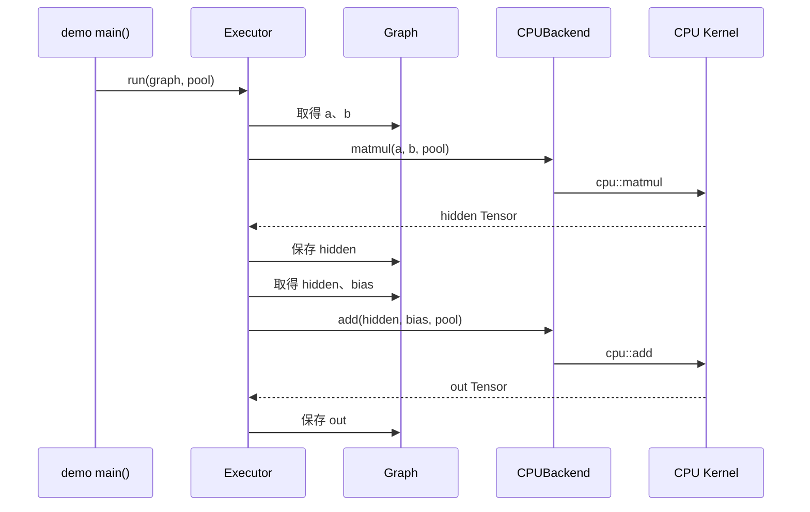

# 第 1 课：跟着四个输出数字走一遍

[课程入口](README.md) · [下一课：数据和内存](02-tensor-and-memory.md)

这一课只学习最小 demo。目标是看懂一次计算经过哪些对象，以及为什么结果是 `32、48、79、104`。

## 1. 先区分三个东西

源码是开发者写的文字。编译器把源码转换成可执行程序。运行程序后，CPU 才按照指令操作内存里的数据。

本项目用 CMake 描述怎样编译。`mini_runtime` 是被其他程序链接使用的库；`mini_runtime_demo` 是具有 `main()` 入口的可执行程序。

文件后缀也有分工：`.h` 通常声明接口；`.cpp` 实现 C++ 逻辑；`.mm` 允许 C++ 和 Objective-C 一起使用，以调用 macOS 的 Metal、音频和界面接口。

先运行：

```sh
./build-app/bin/mini_runtime_demo
```

找到输出中的 `Intermediate Tensor` 和 `Final Output`。现在先不用理解每一行日志。

## 2. 程序要计算什么

打开 [apps/demo.cpp](../../apps/demo.cpp)，从 `main()` 开始。它计算：

```text
hidden = a @ b
out = hidden + bias
```

`@` 在这里是矩阵乘法的数学记号，不是这份 C++ 中的运算符。实际通过 MatMul 节点调用函数。

矩阵就是把数字按行列排列：

```text
a，2 行 3 列        b，3 行 2 列       bias，2 行 2 列
[1  2  3]          [1  2]            [10 20]
[4  5  6]          [3  4]            [30 40]
                   [5  6]
```

输出每一个位置，取 `a` 的一行与 `b` 的一列，对位相乘后加起来：

```text
hidden[0,0] = 1×1 + 2×3 + 3×5 = 22
hidden[0,1] = 1×2 + 2×4 + 3×6 = 28
hidden[1,0] = 4×1 + 5×3 + 6×5 = 49
hidden[1,1] = 4×2 + 5×4 + 6×6 = 64
```

程序中的行号、列号从 0 开始计数。

接下来逐位置加 bias：

```text
out = [22+10  28+20] = [32  48]
      [49+30  64+40]   [79 104]
```

先手算出这四个值，再回去看程序输出。你现在已经知道了这次程序“算数”的全部目标。

## 3. 六个对象分别做什么

| 名字 | 在这次计算中的职责 | 对应源码 |
| --- | --- | --- |
| Tensor | 表示 `a`、`b`、`bias`、`hidden`、`out` | [tensor.h](../../include/runtime/tensor.h) |
| Buffer | 持有实际数字所在的内存及所有权 | [storage.h](../../include/runtime/storage.h) |
| Graph / Node | 记录输入，以及 MatMul、Add 两项任务 | [graph.h](../../include/runtime/graph.h) |
| Executor | 依次取任务、找输入、调用后端、保存输出 | [executor.cpp](../../src/executor.cpp) |
| Backend | 提供“执行这个算子”的接口 | [backend.h](../../include/runtime/backend.h) |
| Kernel | 实际执行乘加循环的函数 | [matmul.cpp](../../src/kernels/cpu/matmul.cpp)、[add.cpp](../../src/kernels/cpu/add.cpp) |

MemoryPool 另外负责为 `hidden` 和 `out` 提供可复用的临时内存，第 2 课展开。

## 4. 跟踪一个输入

在 `main()` 中找到：

```cpp
graph.set_input(
    "a",
    runtime::Tensor::from_vector({2, 3}, {1.0f, 2.0f, 3.0f, 4.0f, 5.0f, 6.0f}));
```

`{2, 3}` 说明二维形状；后面的六个数说明内容；`"a"` 是查找这个 Tensor 的名字。

进入 [Tensor::from_vector](../../src/tensor.cpp)，它依次做四件事：计算形状需要多少元素；分配空间；检查输入确实有六个数；把六个数复制到空间里。

再进入 [Graph::set_input](../../src/graph.cpp)。它把 Tensor 按名字存进 `tensors_`。这里的 `unordered_map` 可以先理解成字典：给出名字，就能找回相应对象。

这时还没有进行矩阵乘法。

## 5. 定义任务与执行任务

这段代码添加一个任务：

```cpp
graph.add_node(runtime::Node{
    .name = "hidden",
    .op = runtime::OpType::MatMul,
    .inputs = {"a", "b"},
});
```

它表示：读名字为 `a` 和 `b` 的两个输入，做 MatMul，把结果保存为 `hidden`。此时只是把 Node 放进列表。

真正启动执行的是：

```cpp
runtime::CPUBackend backend;
runtime::Executor executor(backend, &std::cout);
executor.run(graph, pool);
```

本次执行路线是：



图中“返回 Tensor”包含后端的正常返回过程，并不表示 Kernel 直接引用 Executor。

## 6. 精确跟一次 MatMul

按下面顺序打开函数：

1. [Executor::run](../../src/executor.cpp)：在 `switch` 中找到 `OpType::MatMul`。
2. 它通过 `graph.tensor("a")`、`graph.tensor("b")` 取得输入。
3. 它调用 `backend_.matmul(lhs, rhs, pool)`。
4. [CPUBackend::matmul](../../src/backend/cpu_backend.cpp) 调用 `cpu::matmul(lhs, rhs, &pool)`。
5. [cpu::matmul](../../src/kernels/cpu/matmul.cpp) 检查形状和连续布局，分配输出，然后执行三层循环。
6. 返回后，`graph.store_tensor(node.name, ...)` 把结果命名为 `hidden`。

这里的“后端接口”让 Executor 不用在内部写 CPU 乘加或 Metal 命令。第 5 课会看到同一个接口如何连接 GPU。

## 7. 这次一共用了多少空间

Float32 每个元素占 4 字节：

| Tensor | 形状 | 元素数 | 数字本身的字节数 |
| --- | --- | --- | --- |
| a | `[2,3]` | 6 | 24 |
| b | `[3,2]` | 6 | 24 |
| bias | `[2,2]` | 4 | 16 |
| hidden | `[2,2]` | 4 | 16 |
| out | `[2,2]` | 4 | 16 |

前三个通过 `from_vector()` 独立分配，不计入这个 MemoryPool。后两个从 pool 分配，因此 demo 最后显示 `used bytes: 32`、`allocation count: 2`、`chunk count: 1`。

这个 32 不是整个进程的内存，也不是池子预留容量。Tensor 的元信息、字典、程序和底层内存块还有各自开销。

## 8. 第一批 C++ 语法

| 写法 | 现在先这样理解 |
| --- | --- |
| `runtime::Tensor` | `runtime` 名字空间里的 Tensor 类型 |
| `graph.tensor(...)` | 调用 `graph` 对象的方法 |
| `const Tensor&` | 借用现有对象，并通过此引用只读访问 |
| `float*` | 可以沿着地址访问的一组 float 数字 |
| `data<float>()` | 按 float 类型取得 Tensor 数据地址 |
| `&pool` | 取得 pool 的地址 |
| `OpType::MatMul` | 枚举中的 MatMul 项 |
| `throw` | 发现不满足约束，抛出错误 |
| `std::move` | 允许转移资源；它本身不保证数据被复制或绝不复制 |

这一课不要求你会写模板或智能指针。先用这些解释读通调用路线。

## 9. 三个小实验

先预测结果，再在临时练习副本中修改，或调试观察；保持正式代码和已有测试清楚可追踪。

1. 把四个 bias 都换成 0，输出应该是多少？
2. 把 MatMul 和 Add 节点的添加顺序互换，原始 Executor 会自动调整顺序吗？
3. `a` 的形状仍为 `[2,3]`，但只提供五个数，在哪一步出错？

答案：输出为 `22、28、49、64`；不会自动调整，先执行 Add 时找不到 `hidden`；`Tensor::from_vector()` 检查元素数量时出错，还没有开始执行 Graph。

## 10. 本课过关标准

不用看答案，试着讲出来：

- 为什么调用 `add_node()` 时没有马上算出结果？
- `hidden` 是一个名字、一项任务，还是一组数字？
- 哪一层负责执行顺序，哪一层负责具体乘加？
- pool 的 32 字节为什么不是 App 的总内存？

第二题的完整答案是：在 Node 里它是输出名字；执行后，Graph 的字典里也有了以这个名字查找的 Tensor，Tensor 再指向实际数字。

能讲清这条路线，就可以进入下一课，弄清“数字到底放在哪里”。
