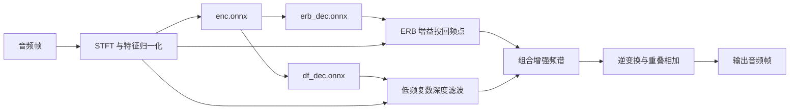

# 第 6 课：声音怎样经过 Hush

[上一课](05-metal-backend.md) · [下一课](07-macos-app.md)

源码入口：[hush_bundle.cpp](../../src/hush_bundle.cpp)、[hush_model.cpp](../../src/hush_model.cpp)、[hush_frontend.cpp](../../src/hush_frontend.cpp)、[hush_session.cpp](../../src/hush_session.cpp)。

## 1. 先把声音理解成一串数字

麦克风测得的波形可以按固定间隔取样，得到一串数。16 kHz 表示一秒 16000 个采样点；单声道表示只有一路数字序列。

当前模型每次推进 160 个点：`160 / 16000 = 0.01 秒`，也就是 10 ms。处理一段长度为 16000 的数组，对应 1 秒，不代表“数组里存了 16000 个字”。

`AudioFrame` 保存格式和样本数组；`AudioStream` 可以把连续输入分成固定大小的帧。App 自己也有 `pending_audio_` 做相似的凑帧工作。

## 2. 模型包怎样加载

```text
hush-real-model.tar.gz
    → read_file：读压缩字节
    → gunzip：用 zlib 解开 gzip
    → parse_tar：按 tar 头和 512 字节对齐读取条目
    → config.ini、enc.onnx、erb_dec.onnx、df_dec.onnx
    → HushConfig 与三张 OnnxGraph
    → HushStreamSession
```

当前解析器处理需要的普通文件条目，并非通用归档软件。`HushConfig` 从配置读采样率、FFT/hop、频带等部分字段，支持范围仍需逐项看实现；不能认为所有 ini 配置都自动生效。

`HushModel` 保存配置和模型图；`HushStreamSession` 借用模型，并保存某一路音频流的执行状态。多路独立录音不应共用一份流状态。

## 3. STFT：从“随时间变化”变成“各频率有多少”

STFT 即短时傅里叶变换。它取一小段波形，乘窗口，再计算各频率的复数值。

当前 Hush 的 FFT 长度为 320，时间跨度为 20 ms；每次推进 160，所以相邻窗口重叠一半。前端保留上一帧，与当前帧组成 320 个点。

```text
上次 160 点 + 当前 160 点
           ↓ Vorbis window
           ↓ 频率变换与缩放
       161 个复数频点
```

实信号频谱对称，因此只需要保存 `320/2+1=161` 个频点。每个复数保存 real 和 imag 两个 float。它们不是两个人的声音，也不是左右声道。

当前 `make_hush_spectrum()` 使用直接频率求和；名字里有 FFT 参数，不等于已经接入了快速 FFT 库。

项目还有通用 [spectral.cpp](../../src/spectral.cpp) 的 Hann 窗教学实现。真实 Hush 使用自己的 Vorbis 窗和归一化，不能随意互换。

## 4. 模型有两路特征输入

ERB 将频点聚合成更符合听觉频带划分的 32 个值，再做对数与逐帧均值归一化。DF 特征取前 64 个复数频点，并按历史幅度状态归一化。

对于 T 帧：

| 数据 | 当前形状 | 含义 |
| --- | --- | --- |
| spectrum | `[1,161,2]`，逐帧生成 | 一帧的实部、虚部 |
| feat_erb | `[1,1,T,32]` | 单样本、单特征通道、时间、ERB 频带 |
| feat_spec | `[1,2,T,64]` | 单样本、实/虚两通道、时间、频点 |

归一化不是每帧独立除以一个固定数。`erb_mean_state_` 和 `df_unit_state_` 会随声音更新，所以同一流必须连续保留它们。

## 5. 三张图各负责什么



Encoder 输出包括 `e0/e1/e2/e3`、`emb`、`c0`、`lsnr`。前几个是不同层的特征，`emb` 是压缩表征，`lsnr` 是模型预测的局部信噪比。

ERB decoder 产生 `m`：每个频带的增益。DF decoder 产生 `coefs`：用于把多个历史频谱组合起来的复数系数。

“decoder” 在这里指恢复/预测增强参数的网络部分，不是 LLM 的文本 decoder。

## 6. 为什么需要复数深度滤波

ERB mask 主要按频带调整增益。DF 还会利用多个历史时刻，在每个低频频点做复数加权：

```text
增强频点 = 系数0 × 历史频点0
         + 系数1 × 历史频点1
         + ...
         + 系数4 × 当前频点
```

复数乘法要同时处理实部和虚部。当前 `apply_deep_filter()` 维护前 4 帧的低频历史，处理 5 阶系数。第一段没有足够历史时使用零。

随后将低频 DF 结果与较高频的 ERB mask 结果合起来。这里每个“频点”代表信号的一部分，不是给不同说话人各分配一个位置。

当前导出包没有提供一个推理时可直接选定“张三”或“李四”的说话人身份输入；辅助 separation head 在上游训练中使用，不是现有包里漏调用的一个独立分离输出。

## 7. 合成：恢复波形

`synthesize_hush()` 从半边频谱构造实信号所需的对称频谱，进行逆变换、乘窗口、与上一次的后半窗口重叠相加。

本项目分析阶段已经缩放过，因此不能看到逆变换就再随意加一个除以 FFT 大小的操作。

`synthesis_history_` 保存上一轮留给下一帧的波形部分。直通分析/合成检查中需要对齐约一个 hop 的起始延迟；重采样、设备缓冲和推理还可能带来其他时间开销。

输出长度正确只能证明长度契约，不能证明频谱、音色或说话人保留正确。

## 8. 把函数调用串起来

真实模型的一帧通常沿以下路线：

```text
process_audio(frame)
    → 识别真实模型的 Conv 图路径
    → process_audio_batch({frame})
    → frontend_.process(frame)
    → process_encoder(..., encoder_stream_state_)
    → process_decoders(..., erb_stream_state_, df_stream_state_)
    → ERB mask / apply_deep_filter
    → synthesize_hush
    → AudioFrame
```

32 帧批处理使用同一套连续机制，并按实际批次长度执行；`32×160/16000=0.32 秒` 说明这一批包含多少音频，不说明每 10 ms 都重算整批历史。

`frame_index()` 在当前实现里随 encoder 执行次数递增。一批 32 帧只调用一次 encoder，因此它不是所有调用方式下都等于音频帧总数。

## 9. 这条流有多少种记忆

| 状态 | 保存什么 |
| --- | --- |
| 前端 history | 上一次的采样点 |
| ERB/DF normalization state | 逐频带/频点的历史统计 |
| Encoder/decoder recurrent state | 各 GRU 的隐藏状态 |
| Encoder/decoder padding state | 因果卷积的真实历史特征 |
| `df_history_` | 深度滤波要用的历史频谱 |
| `synthesis_history_` | overlap-add 的历史波形 |

`pool.reset()` 只清临时分配位置；`session.reset()` 清流状态。这两个 reset 不能替代彼此。

## 10. 自测

1. `[1,2,T,64]` 中的 2 为什么不是双声道？
2. 每 32 帧清空 GRU 和卷积历史会发生什么？
3. Mask 和 DF 系数是不是“模型原始声音文件”？
4. 数值与参考一致，为什么主讲仍可能变糊？

答案：这里表示实部/虚部；会改变上下文并可能产生块间不连续；它们是用来处理输入频谱的预测参数；参考模型本身也可能误抑制这类输入，数值正确性不能代替模型质量。
