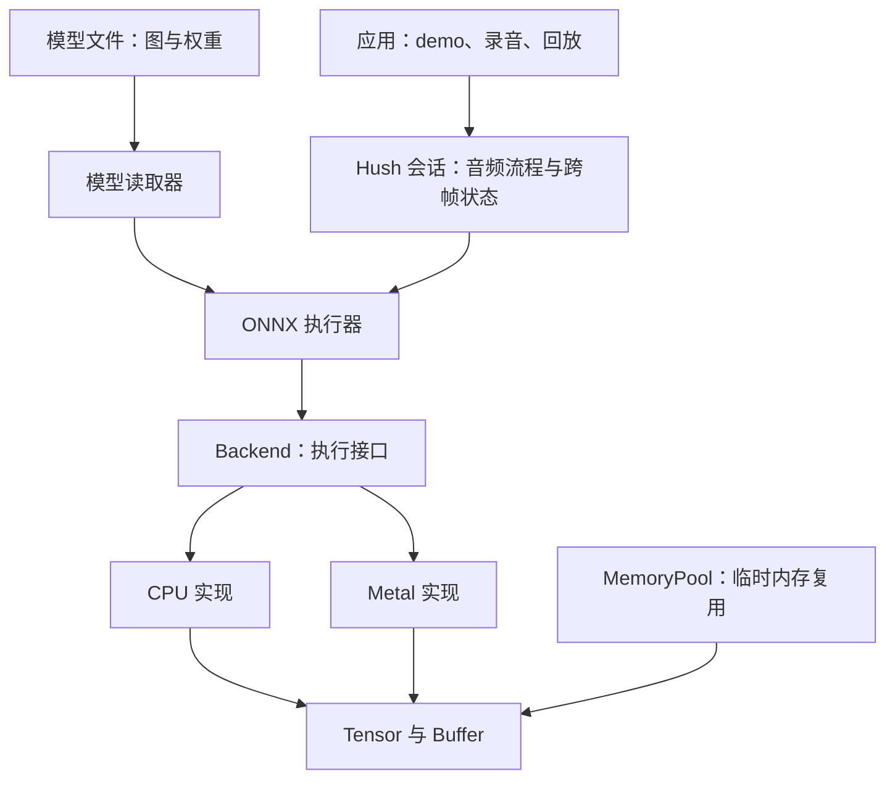

# 从 0 到 1 读懂当前 Runtime

这是一套按当前源码编写的中文教程。默认你没有推理框架开发经验；涉及 C++、GPU、音频的新概念，会在使用时解释。

这里的“读懂”有三个标准：你能用自己的话说明一个模块负责什么；你能沿着调用找到实际执行的函数；你能通过一个小实验预测修改后的结果。

## 先回答：runtime 的工作全部完成了吗

需要按范围回答，不能用一个“全部完成”概括。

| 范围 | 当前情况 |
| --- | --- |
| 最小 Tensor、CPU 算子、内存池、计算图 | 已实现，可以运行并用于学习 |
| 当前 Hush bundle 的读取和三张 ONNX 子图执行 | 已实现，并做过 CPU/Metal 与参考计算对照 |
| Hush 流式状态、音频重建、macOS 录音与回放 | 已接通，有数值、长度和内存回归验证 |
| 当前模型的主讲保真、背景人声分离效果 | 尚未达到目标，部分演示语音会被误抑制 |
| 任意 ONNX 模型、完整 ONNX 类型和算子语义 | 尚未实现 |
| 全图驻留 GPU、跨算子融合、异步流水线 | 尚未完成，当前有逐算子同步和 CPU 路径 |
| 量化、多精度、成熟框架级内存规划和并发执行 | 尚未完成 |
| LLM、Attention、KV Cache、完整 decoder | 当前源码没有实现 |

当前可以把项目当作一个有真实 Hush 应用的、小型推理运行时来学习。不要把模型音质差全部归给 runtime，也不要因某个模型跑通就认定 runtime 对所有模型都正确。

## 项目到底做什么

模型提供“计算步骤和参数”；runtime 负责把数据放好、按顺序执行这些步骤、管理内存并取得结果。Hush 的训练不在本项目中。



这是一张职责图，不代表每次执行都经过全部模块。第 1 课的最小 demo 不使用 Hush 和 ONNX。

## 课程顺序

| 课 | 内容 | 学完能回答的问题 |
| --- | --- | --- |
| [1. 跑完一次最小计算](01-first-computation.md) | 工程入口、矩阵、六个核心对象、C++ 入门词汇 | 两个 Node 如何算出四个数字？ |
| [2. 数据和内存](02-tensor-and-memory.md) | Buffer、Tensor、shape、stride、view、内存池 | 数据在哪里？谁释放？reset 后还能读吗？ |
| [3. CPU 算子](03-cpu-kernels.md) | Add、MatMul、形状变换、卷积、GRU | 真正做乘加的代码在哪里？ |
| [4. 计算图和 ONNX](04-graphs-and-onnx.md) | 两套图、Protobuf 读取、拓扑排序、prepare、分发 | 文件里的模型怎样变成函数调用？ |
| [5. Metal 后端](05-metal-backend.md) | Device、Buffer、Pipeline、命令、同步、缓存 | CPU 如何让 GPU 算出一个结果？ |
| [6. Hush 音频推理](06-hush-pipeline.md) | 采样、STFT、ERB、三张图、DF、重建、状态 | 一段声音怎样变成模型输入再恢复成声音？ |
| [7. macOS App](07-macos-app.md) | 事件回调、采集、转换、录制、后台处理、ARC | 点按钮后运行了哪些函数和线程？ |
| [8. 测试和工程判断](08-testing-and-boundaries.md) | 正确性、性能、内存、音质、现有限制 | 什么证据才允许说“完成了”？ |

查找某个文件时，使用 [完整源码地图](source-map.md)。这份地图也覆盖 CLI、浏览器可视化和测试工具。

每课按“先看现象 → 理解概念 → 对照函数 → 做实验 → 回答自测”的顺序阅读。每次读完一课即可，不必一次背完所有术语。

## 开始前准备

macOS 需要 CMake 和 Xcode Command Line Tools。打开终端，进入项目目录，先运行不需要模型、麦克风或 GPU 的最小 demo：

```sh
cmake -S . -B build-app -DCMAKE_BUILD_TYPE=Release
cmake --build build-app -j4 --target mini_runtime_demo mini_runtime_tests
./build-app/bin/mini_runtime_demo
ctest --test-dir build-app -R '^mini_runtime_tests$' --output-on-failure
```

这组命令会使用已有的 `build-app` 配置。初次配置时如果缺少模型 bundle，CMake 可能提示 App 未内置模型；这不影响以上两个入门目标。课程中的真实模型测试另有依赖，不要把跳过模型测试当作已经执行。

## 资料之间如何对应

- 本目录解释当前实现，是现在的主阅读入口。
- [早期源码阅读指南](../source-reading-guide.md) 可以补充最小 CPU 部分的细节。
- [原学习路线图](../runtime-learning-roadmap.md) 包含未来方向，不能当作已实现功能清单。
- [Hush 音频验收](../hush-audio-validation.md) 记录参考对照、测试方法与音质边界。
- [Runtime 落地复盘](../runtime-implementation-retrospective.md) 记录实现过程中遇到的难题、错误判断、修复方法和仍未完成的部分。

阅读时遇到疑问，尽量具体到“哪个对象、哪个函数、哪一组输入”。例如：“`out` 为什么是 16 字节？”比“内存我都不懂”更容易一步步弄清楚。
