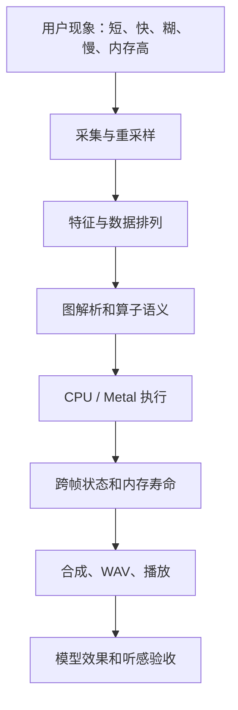

# Runtime 落地复盘：遇到了什么问题，如何解决，还有哪些没解决

本文整理从最小 CPU runtime，到 Hush ONNX、Metal、macOS 麦克风 App 的主要工程问题。面向零基础读者：先说明现象，再解释机制，最后列出修复和验证依据。

记录范围截至 2026-10-24，依据当前源码、Git 提交历史和本项目实测。过去的实验数字只代表当时的输入、机器和代码版本，不构成所有场景的性能或音质保证。

配套资料：[源码课程](runtime-from-zero/README.md)、[完整源码地图](runtime-from-zero/source-map.md)、[Hush 音频验收](hush-audio-validation.md)。

## 1. 先看全局：难点分布在哪里

| 问题 | 为什么难 | 当前状态 |
| --- | --- | --- |
| 最小算子能跑，真实 ONNX 仍无法执行 | 文件类型、属性、形状与图连接都需要兼容 | 当前 Hush 路径已接通，通用 ONNX 仍受限 |
| 音频有输出但很糊 | 数据排列、特征归一化、GRU、重建都可能出错 | 已修正发现的计算错误；模型仍会误伤部分声音 |
| 分批后出现块间不连续 | 多种跨帧状态的生命周期不同 | 当前 Hush 流状态已保留，并有回归验证 |
| Metal 没有想象中快 | 小算子提交、等待、复制、分配抵消 GPU 收益 | 已做缓存等优化，完整异步/融合仍未完成 |
| 长录音播放只剩几秒 | 采集、转换、模型处理、写文件形成多段流水线 | 当前 A/B 路径已做完整录音验证 |
| 点击录音崩溃或启动停住 | 错误处理、线程共享、权限和签名都可能参与 | 修正已定位路径，不能视为穷尽全部设备异常 |
| App 内存涨到 GB 级 | CPU arena、Metal 缓存与 Objective-C 生命周期交织 | 已修正主要根因，并做压力测试 |
| Demo 看似有效，实际主讲也被抑制 | 测试素材与验收指标不合适 | 改为独立语音对照，质量目标仍未达成 |
| 阶段越来越多，容易误判“全部完成” | 功能存在、执行正确、性能和用户效果混在一起 | 已拆分验收口径并补课程/边界说明 |

这些问题并非都由“模型不好”或“GPU 不够快”造成。需要先确认问题发生在哪一层。



图表示排查层级。实际诊断应根据证据缩小范围，不是每次都从头重跑所有检查。

## 2. 难点一：从小测试走向真实模型

### 2.1 小图能执行，不代表真实 ONNX 已兼容

最初的手写 Graph 只有 Add 和 MatMul，测试模型的形状、属性和输入类型也较简单。真实 Hush 包含 Shape、Constant、Slice、Gather、Einsum、分组卷积、动态 reshape 和多层 GRU。

难点不仅是“缺一个算子”：同名算子还会有不同 dtype、属性、输入位置与布局要求。

处理方法是先增加模型 inventory，再逐步补读取和执行能力：

1. 解压 bundle，检查配置和三张子图是否齐全。
2. 读取图的正式输入/输出、initializer 和节点属性。
3. 列出真实模型使用的 op，区分认识的名字和可执行的语义。
4. 用最小 fixture 验证解析，再用真实模型验证连接关系。

源码：[hush_bundle.cpp](../src/hush_bundle.cpp)、[onnx_weights.cpp](../src/onnx_weights.cpp)、[hush_model.cpp](../src/hush_model.cpp)、[hush_inspect.cpp](../apps/hush_inspect.cpp)。

**留下的边界：**部分整数和半精度参数被转成内部 Float32 表示，Cast、索引和形状处理也有限制。当前 Hush 能跑，不代表已完整实现 ONNX 标准。

### 2.2 权重布局和分组计算不是只看 shape

Hush 的 grouped linear、分组 Conv 和 ConvTranspose 要求每组读取正确的输入通道和权重片段。把所有通道混在一起，可能仍得到有限值，形状也可能看起来合理，但数值语义已错。

解决时补充了 groups 的映射、特定 Einsum 路径和对应验证。后来还发现 CPU 分组反卷积混用了其他组输入，再单独修正并加入固定数值测试。

证据：`4a82b2e`、`2e9f6c6`、`be5a2d3`、`d7bbbd5`；回归入口为 `test_grouped_transpose_padding`。

**经验：**先写清楚每个维度的含义，再推导下标。两个 Tensor 的元素数相同，不代表数字的排列或分组相同。

## 3. 难点二：音频有输出，却一直很糊

这部分曾经最容易被“长度正确、数值有限”掩盖。后来通过独立参考逐层对照，才拆出了多个不同根因。

### 3.1 通用前端没有完全对齐 Hush 的训练约定

项目先实现了通用 Hann 窗 STFT/ISTFT，Hush 则需要特定的 Vorbis window、频谱缩放、ERB 频带、对数稳定常数和归一化初始状态。

窗口是取一小段音频时施加的权重；归一化是把模型输入调到训练时预期的范围。它们任一项不匹配，都可能让模型收到分布不合适的输入。

后续对齐了：

- Hush 的 Vorbis window 和分析/合成缩放。
- ERB 频带宽度、按频带聚合与逆投影。
- ERB 对数值、均值归一化、DF 幅度归一化及初始状态。
- 输入特征中时间、频率、实部和虚部的排列。

源码：[hush_frontend.cpp](../src/hush_frontend.cpp)、[hush_session.cpp](../src/hush_session.cpp)。证据：`675f842`、`d7bbbd5`。

**经验：**前端是模型输入契约的一部分。只证明自己的 STFT 能还原自己的 ISTFT，尚不足以证明它符合模型训练要求。

### 3.2 Pad 把时间和频率的数据排列打乱

Pad 原本应将输入复制到“补了边界后的正确位置”。旧代码按错误的维度顺序累计目标下标，把某些多维数据的位置打乱。

它为什么难发现：

- 输出 shape 正确。
- 数据仍在已分配空间里，不一定崩溃。
- 后面的卷积、GRU 都能继续产生有限结果。
- 最终听起来像模型能力差，而不是一个索引公式错了。

排查方法是把各节点结果导出，与 ONNX Runtime 比较，找到第一个不一致节点。Pad 修正为按输出 stride 计算目标位置后，encoder 和 DF 路径的差异明显消失，剩余差异进一步定位到了反卷积边界。

修复：[pad_tensor](../src/onnx_executor.cpp)；回归：`test_onnx_stream_padding`；证据：`d7bbbd5`。

**经验：**“第一个出错节点”往往比“最终声音糊”更接近根因。形状检查应配合带不同数字的内容检查。

### 3.3 GRU 更新公式、初始状态位置与 reset 语义不一致

GRU 的隐藏状态是一组跨时间保存的数字。ONNX 的更新规则是：

```text
新状态 = update × 旧状态 + (1−update) × 候选状态
```

曾遇到的具体问题包括：

- 将两个混合比例写反。
- 将 `sequence_lens` 的输入位置误当作 `initial_h`，没有正确使用非零初始状态。
- `linear_before_reset` 的两种语义没有完整区分。
- 融合实验中循环 bias 的处理不完整。

修复 Hush ONNX 路径时，引入带非零初始状态、两种 reset 模式的已知参考输出，同时验证分段执行经过 pool reset 后仍与整段一致。

源码：[run_gru_step](../src/onnx_executor.cpp)；回归：`test_onnx_gru_reference`；证据：`d7bbbd5`。融合实验的 bias 修改见 `99aab14`。

**尚未全部解决：**基础 `cpu::gru_step()`、Backend GRU API 和 Hush ONNX GRU 是不同路径，基础接口仍有语义差异，不能共享同一份“已正确”的结论。

### 3.4 反卷积漏算最后一个频率位置

真实 decoder 的 ConvTranspose 使用 `output_padding=[0,1]`。忽略这个属性，会让应为 16 的频率宽度变成 15，应为 32 的宽度变成 31。

曾经允许相差一个位置的广播相加，让形状问题没有立即暴露，但缺失的数据没有因此恢复。

解决方法是把 output_padding 贯穿 ONNX 属性读取、Backend 接口和 CPU/Metal 输出网格计算，并恢复严格的广播形状约束。同时修正 CPU groups 的隔离。

回归：`test_grouped_transpose_padding`；证据：`d7bbbd5`。

**经验：**遇到形状不匹配，应先追查上游语义。容忍缺一列的数据，会把明确报错变成更隐蔽的失真。

### 3.5 流被切成小批次，模型记忆却没有延续

将音频按 32 帧处理降低了重复执行成本，但如果每批都从零隐藏状态和零卷积历史开始，整段音频就会变成许多不连续的小段。

实际需要保存的不只有 GRU：

| 状态 | 保存什么 |
| --- | --- |
| 前端采样 history | 上一个窗口的采样点 |
| ERB/DF normalization state | 历史频带/频点统计 |
| GRU recurrent state | 网络记忆 |
| causal Pad history | 卷积所需的历史特征 |
| DF history | 深度滤波所需的历史频谱 |
| synthesis history | overlap-add 所需的历史波形 |

后来增加 `OnnxStreamState`，将 GRU 和因果 Pad 历史复制到独立 Tensor。实际批次按真实长度执行，不让末批额外补帧推进流状态；新会话再统一 reset。

**为什么必须复制到独立空间：**pool reset 后底层块可能还存在，但同一位置已经允许被下一轮覆盖。共享所有权只保证空间未释放，不能保证旧数值未被改写。

证据：`d7bbbd5`；验证包含整段参考、逐帧/32 帧和跨 pool reset 的对照。

## 4. 难点三：GPU 优化不能只看“写了 shader”

### 4.1 小算子的固定开销可能超过计算本身

当前 Metal 接口中，一次算子调用可能包含输入 memcpy、Buffer 准备、命令创建、GPU 提交、等待和结果回读。Hush 中算子较小，反复做这些动作的成本很明显。

已落地的优化包括：

- 缓存已构建的 Metal pipeline。
- 缓存相同权重内容的 Metal Buffer。
- 按大小/用途复用输入和输出 Buffer。
- 对固定图 prepare，缓存 ONNX 执行计划和 initializer Tensor。

证据：`fdce380`、`9e5a1d9`、`675f842`。源码：[metal_backend.mm](../src/backend/metal_backend.mm)、[onnx_executor.cpp](../src/onnx_executor.cpp)。

**仍有限制：**当前仍有逐算子 `waitUntilCompleted`、回读复制和 CPU 执行分支。尚未实现整张图常驻 GPU、完整的跨算子融合和异步流水线。权重缓存也不等于权重被“编译成 GPU 程序”。

### 4.2 GRU 融合实验出现稳定性问题

序列 GRU 的融合 shader 需要在多线程之间协调历史状态，并正确处理门控、bias 和每个时间步的同步。少量样例快，不代表长时间运行仍正确。

项目尝试了融合序列路径，修过循环 bias，并保留了默认稳定路径。历史验收中，实验路径未通过充分的有限值/稳定性检查，不能当作默认生产能力。

当前 Hush 的 ONNX GRU 实际由执行器中的 CPU 实现处理；MetalBackend 基础 GRU 方法还存在直接回退和不可达 GPU 编码段。

证据：`91638ec`、`520f966`、`86e3a89`、`99aab14`。这部分的结论是“实验与回退并存”，不是“全模型 GRU 融合已经完成”。

### 4.3 benchmark 的单位曾造成错误印象

32 个时间步包含 320 ms 音频。整批耗时除以 32，才得到摊销的“每 10 ms 音频处理成本”。

```text
示例：处理 320 ms 音频耗时 64 ms
    → 整批执行耗时：64 ms
    → 吞吐摊销：2 ms / 每 10 ms 音频
```

后者不能证明单帧请求 2 ms 内返回，也不包含全部设备缓冲与前后端延迟。历史讨论中的约 301.81 ms/frame，不能与后来的批摊销值直接比较并宣称获得了同等倍数的延迟优化。

提交 `46808fe` 修正了 benchmark 的标注，并增加分位数输出。但当前迭代次数少、范围有限，仍不足以证明长期 p99 或完整实时音频 SLO。

### 4.4 有了执行计划，还没有完整内存规划

拓扑排序解决“先执行谁”；live value 分析记录“谁还会被使用”；内存规划则要决定“什么时候能释放或复用哪一段地址”。三者不是同一个功能。

项目增加了执行计划、使用次数和正式 graph outputs 的识别，避免未来只根据普通使用次数就误判输出寿命。

证据：`4d32e53`、`7af8177`、`dce4f5d`、`45eb5bd`。

**当前仍保留全部运行值字典，尚未据此完成全图内存复用。**另外，字典中的 191/252/289 等历史计数包含中间值，不能当作三张 ONNX 图对外输出数量。

## 5. 难点四：长时间录了，播放却只剩两三秒

### 5.1 不能只盯着播放器

同一症状可能来自不同环节：设备采集长度不完整、转换回调只消费了部分数据、固定输出容量不足、样本率解释错误，或者推理阻塞导致没保存完整录音。

例如一组采样点应该按什么速度播放，由文件中的采样率决定。样本数量、采样率和时长必须一起看，而不是只判断“能听到声音”。

项目先后修正了转换输入的消费过程、读取完整数据的方法和采集/处理边界。部分局部修复没有消除用户复现的问题，最后调整了整个 A/B 录音路径：

```text
录制期间保存设备格式样本
    → 用户停止
    → 移除 tap、停止引擎，固定完整录音边界
    → 分块提供全部样本给重采样器
    → 离线 Hush 处理完整录音
    → 按原始样本数写出三路 WAV
```

证据：`ab857ea`、`e733182`、`9b554d5`、`a351b45`、`716c3d5`、`5fec1da`。

验证时查看 WAV 的实际采样率、样本数和时长，而不是仅观察按钮。一次实际录音中，Raw/Bypass/Hush 均为 `921600 samples / 16 kHz = 57.6s`，Raw 与 Bypass 哈希一致。

**仍有限制：**当前录音保存在内存数组中，长录音会正常增加内存；它还不是固定内存的长时间磁盘流式录制方案。实时监看和离线 A/B 也是不同路径，不能互相代替所有验证。

### 5.2 音频回调中同时做太多工作

在采集回调里同步做推理、重采样或文件 I/O，会让完整性受这些操作的耗时影响。最终 A/B 录制分支专注保存样本，停止后再后台转换与推理。

这降低了“录完整音频必须每帧及时推理”的耦合，但并没有完成所有实时调度工作：非录制的实时监看仍在 tap 内同步推理，尚需有界队列和独立工作线程设计。

### 5.3 错误路径本身造成崩溃

将 `NSError.localizedDescription.UTF8String` 直接交给 C++ 字符串/异常构造，在错误对象或描述为空时可能拿到空指针。

`423fe0c` 增加 `error_message()`，在转换边界检查 UTF-8 指针并提供稳定 fallback。后来还给音频线程与 UI 共享的错误字符串增加 mutex，避免并发读写。

**经验：**错误处理需要自己的验证。不能假定“发生错误时总能取得一段正常文字”。这些修复只覆盖已经定位的路径，不代表拔插设备、设备切换等异常都已穷尽。

### 5.4 防削波只能解决一种失真

`64b4765` 增加输出峰值保护：需要时按整段比例缩放，降低超出 PCM 范围而削波的风险。

它不会恢复已经丢失的主讲频谱，也不会让模型知道应该保留哪个说话人。整体音量处理和选择性背景人声分离是不同问题。

## 6. 难点五：App 内存涨到几十 GB

### 6.1 同时存在三套内存生命周期

| 层级 | 管理机制 | 潜在问题 |
| --- | --- | --- |
| C++ | Buffer、Tensor、vector、MemoryPool | 历史块未复用、录音数组增长、状态指向临时池 |
| Metal | MTLBuffer 和缓存 | 重复创建、按动态内容无限缓存、并发覆盖 |
| Objective-C | ARC 与 autoreleasepool | 临时对象不能及时释放或持有关系不正确 |

因此只给 Metal Buffer 加缓存，或者只启用 ARC，都不足以证明总内存问题已解决。

### 6.2 真正持续增长的 arena 复用缺陷

旧 `reserve_chunk()` 只查看最后一个 chunk。一轮推理用过多块后，即使 reset 清了所有块的 offset，下一轮也只从最后一块开始；它装不下时又追加新块，前面的块不断闲置。

这不是“所有临时 Tensor 都没有析构”那么简单，而是池子仍然持有越来越多没有充分复用的底层块。

修复后扫描全部已有 chunk，能容纳请求就复用，并加入多 chunk 回归测试。与此同时启用 Objective-C++ ARC，在音频回调加入 autoreleasepool，改进 Metal Buffer 复用，并缓存 prepare 后的权重。

证据：`675f842`；源码：[memory_pool.cpp](../src/memory_pool.cpp)；测试：`test_memory_pool_reuse`、[hush_memory_tests.mm](../tests/hush_memory_tests.mm)。

### 6.3 修复是靠曲线和分类确认的

第一次尝试后，App 在数分钟内仍到 GB 级，`vmmap` 中主要增长在 `MALLOC_MEDIUM`。这说明不能只因编译成功、ARC 已开启就宣布修复。

继续定位 arena 后，实际实时运行的一段约 44 秒观察窗口中，physical footprint 从约 `67.8 MiB` 到 `67.7 MiB`；保存约 57.6 秒 A/B 录音后约为 `104 MiB`。独立模型压力测试另有较小的稳定 footprint 记录。

这些数值分别对应 App 和独立工具，不能混为同一指标。录音后多出的样本数组，也不能与每帧推理持续追加 arena 块混为一谈。

**经验：**先区分 VSZ、RSS、physical footprint、pool used 和录音数据量，再比较预热后的变化。短窗口稳定仍应结合更长时间和实际负载验证。

## 7. 难点六：能编译，但 App 未必能采音和完整分发

### 7.1 模型资源不能只存在于开发者的临时目录

最初依赖环境变量或 `/tmp` 下的 bundle，用户直接双击 App 时可能没有模型。后续通过 CMake 将模型与演示资源复制进 App Resources。

模型原始路径仍应在构建配置中明确存在；旧构建目录里残留资源可能掩盖 fresh build 的打包缺项。

证据：`66731c7`、`675f842`、`e77b1a0`。当前 App 能携带模型运行，不代表 Git 仓库包含模型权重，新的构建环境仍需提供 bundle。

### 7.2 麦克风权限和签名会影响测试

重建后签名与旧授权不匹配，曾出现 UI 停在请求权限的状态。另一次签名校验发现资源封装状态不完整。

后续区分已授权/未决定/拒绝状态，使用 AVCaptureDevice 权限 API；构建后在复制资源完成的基础上重新做本地 ad-hoc 签名，再校验 bundle。

系统授权仍由用户操作。权限回调没有完成，不应立即归因于 Metal 推理死锁；签名通过也不等于正式开发者签名、公证或分发全流程完成。

### 7.3 UI、音频线程与后台任务不能随意共享对象

音频回调更新波形和错误，主线程定时读取；录音结束后后台处理，再回主线程更新 UI。共享字符串/vector 需要保护，UI 操作需要回主线程。

演示生成后来使用独立 Backend/Session 并持有模型副本，减少与实时路径共用可写 Metal 临时缓存的风险。

**仍有限制：**这不构成通用线程安全保证；Backend 切换、多流并发、音频设备热切换仍需专门设计与测试。

## 8. 难点七：数值正确了，主讲仍然被抑制

### 8.1 最初的“背景人声 Demo”素材不合适

最初混合的是两组调制正弦信号，而不是真正的语音。它能验证流程和频率处理，却不足以评价说话人分离。

后来换成两段独立中文合成语音，提供主讲参考和不同输入 SIR 档位。SIR 是主讲与干扰的能量比；`0 dB` 表示两路 RMS 相同，`18 dB` 表示主讲明显更强。

素材来源、文本和生成命令已写入 [resources/README.md](../apps/resources/README.md)。合成语音有可重复、可取得独立参考的优点，但仍不能替代多种真人声音、语言、距离和设备条件。

### 8.2 “主讲更响”是训练条件，不是质量保证

上游说明当前模型主要在背景比主讲低约 `12–24 dB` 的条件下训练，辅助 separation head 只用于训练，并非当前导出包中缺少调用的一个独立推理分离器。

用户已明确反馈主讲人更近、更响，受控测试中也存在相同条件下主讲被削弱的情况，因此不能把问题一概归因于用户没有按训练音量测试。

### 8.3 通过单人对照和官方前端缩小责任范围

在一组长约 `10.37s`、输入 SIR 约 `12 dB` 的中文合成语音中，补偿 160 samples 合成延迟后得到：

| 检查 | 记录结果 |
| --- | --- |
| 混音相对主讲参考 SI-SDR | 约 `11.99 dB` |
| Hush 输出相对主讲参考 SI-SDR | 约 `1.60 dB` |
| 只输入干净主讲时，整体 RMS 电平变化 | 约 `−8.57 dB` |
| 官方 DeepFilterLib 前后端 + 同一 ONNX 权重，对 runtime 浮点输出最大误差 | 约 `4.88e-6` |

SI-SDR 是将参考与输出对齐后衡量残余失真的指标，对统一放大/缩小音量不敏感。因此这组结果不能靠把播放器音量调大就视为保真恢复。

这里的官方参考具体是 **DeepFilterLib 前端/合成器 + ONNX Runtime 执行同一 ONNX 权重**，不是宣称对全部上游 checkpoint、全部语言或所有原生部署参数都做了验收。

证据范围也必须说明：结果证明当前权重对这组素材会误抑制，不能外推为所有真人语音都会失败；同时也不足以将这版模型标成目标说话人分离质量合格。

### 8.4 阈值试改被撤回

诊断中曾尝试对齐上游原生部署的局部 SNR 分阶段策略。输出整体 RMS 下降，一度被过早解释为背景抑制更强。

这个判断不成立：整体 RMS 下降也可能是主讲人被压低。在没有独立主讲/背景质量收益证据前，该试改被撤回，当前实现保留对齐已有参考的处理路径。

**这类诊断试验没有形成保留在当前源码中的功能。**复盘应记录失败判断，但不能把它写成“已完成的一次音质优化”。

## 9. 验收方法上最重要的失误和改进

### 9.1 曾经把几种不同的“成功”混为一谈

落地过程中曾出现这样的判断跳跃：模型加载成功、输出长度正确、数值有限、CPU/Metal 一致，就认为整体已经完成。用户实际录音、长时间运行和试听继续暴露了问题。

其中 CPU/Metal 一致尤其容易误导：两条路径可能复用同一段 CPU 代码，也可能复制同一个错误公式。历史 CPU/Metal GRU 对照通过，就未能替代后来需要的独立 ONNX 语义测试。

现在将验收分开：

| 验收层 | 最少要回答的问题 |
| --- | --- |
| 文件/接口 | 模型齐不齐？shape、dtype、采样率、样本数对不对？ |
| 数学语义 | 是否符合独立定义、黄金数值或参考实现？ |
| 状态与内存 | reset 后有效期正确吗？长时间是否持续增长？ |
| 性能 | 测的是单帧、整批、吞吐还是端到端延迟？ |
| 用户质量 | 主讲是否保留？背景是否下降？是否产生失真？ |

### 9.2 修复后要覆盖用户真正失败的路径

命令行能跑，不等于 GUI 可以录完整音频；合成信号通过，不等于真人录音通过；离线 A/B 通过，不等于实时回调不会积压。

比较有效的做法是固定同一输入，记录修改前后，沿层级缩小差异，再回到用户路径复现。参考脚本、内存测试、WAV 样本数和真实 App 操作分别负责不同证据。

### 9.3 原型、默认路径和未完成项要明确标注

写过某个 shader，不代表实际走了它；完成拓扑排序，不代表有了并行调度；完成一个模型适配，不代表通用 runtime 全部完成。

当前仍应继续完善 Tensor 边界、基础 GRU、ONNX 类型/属性覆盖、全图内存规划、CPU/GPU 复制与同步、实时音频调度，以及真实说话人质量验收。源码课程已将这些边界与已完成路径分开。

## 10. 初学者怎样使用这份复盘

不必按历史提交顺序逐个背。先完成源码课程中的对应概念，再回来读相关问题：

| 学完课程 | 回看本篇 |
| --- | --- |
| Tensor 与内存 | 第 6 节：为什么有 reset 仍能内存暴涨 |
| CPU 算子和 ONNX | 第 2～3 节：布局、Pad、GRU、反卷积 |
| Metal | 第 4 节：缓存、融合、同步和计时口径 |
| Hush | 第 3、8 节：连续状态与模型误抑制 |
| macOS App | 第 5、7 节：长录音、权限、线程与打包 |
| 测试与工程判断 | 第 9 节：什么算通过，什么仍未证明 |

以后定位一个问题，可以记录这几个最有用的信息：复现输入与版本、实际执行路径、预期/实际值、首个出现差异的位置、修复原因、回归证据，以及尚未覆盖的条件。

## 11. 如何在 Git 中查证

提交就是一次源码快照。本文的短编号可在项目根目录查询：

```sh
git show d7bbbd5 -- src/onnx_executor.cpp
git show 675f842 -- src/memory_pool.cpp
git show 5fec1da -- apps/hush_mic_ui.mm
git show 46808fe -- apps/hush_benchmark.cpp
```

| 提交 | 主要查什么 |
| --- | --- |
| `0178677` | 真实 initializer 类型适配 |
| `520f966`、`99aab14` | 融合 GRU 原型与 bias 修改 |
| `46808fe` | benchmark 批次与摊销计时口径 |
| `45eb5bd` | 正式 graph output 的寿命识别 |
| `423fe0c` | 空错误描述的 C++ 转换保护 |
| `5fec1da` | 完整录音采集、转换与回放错误处理 |
| `675f842` | 内存池复用、ARC、Buffer/权重缓存和压力验证 |
| `d7bbbd5` | Pad、GRU、ConvTranspose、流状态和独立参考 |
| `e77b1a0` | 两段独立语音的可控演示 |
| `2abfdaa` | 当前源码课程与能力边界梳理 |

提交标题中的“完成”“验证”等措辞描述当时的工作范围。判断现在的能力，应同时阅读后续修复、当前调用路径与尚未解决项。
