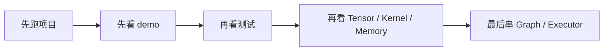
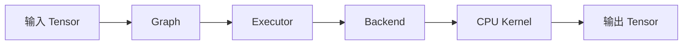
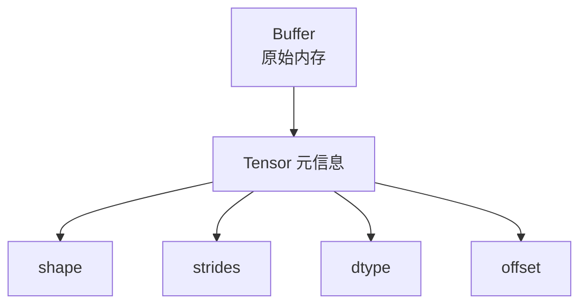
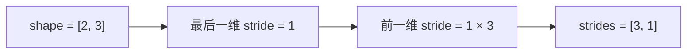
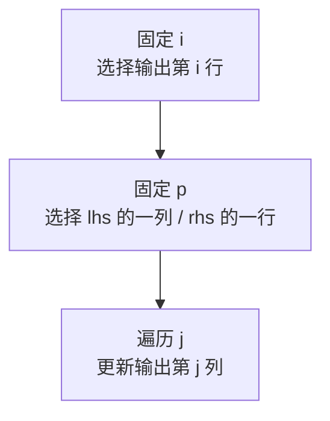
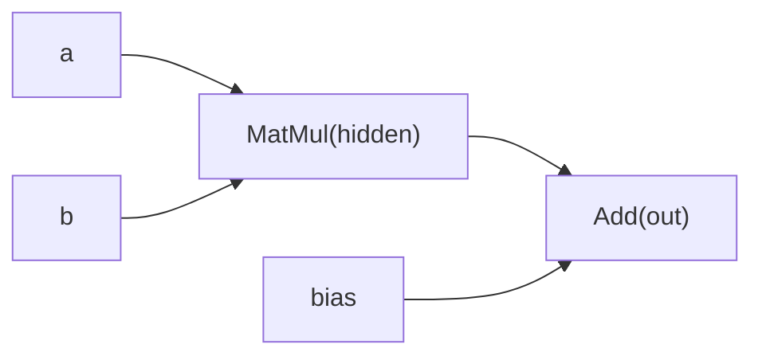

# 源码阅读 Guide

这份 guide 是按“小白第一次读这个工程”的视角写的。

目标不是一下子把所有细节都吃完，而是带你按一个合理顺序，逐步建立下面这几个认知：

- 这个工程到底在干什么
- 每个文件分别负责什么
- 数据是怎么在 runtime 里流动的
- 一次最小计算是怎么从输入走到输出的

如果你愿意，建议你真的一边打开代码一边跟着读，不要只看这份文档。

## 先别急着读代码

第一次看 runtime 源码，最容易犯的错是：

- 一上来就钻进 `tensor.cpp`
- 结果每个词都认识，但整体完全没有方向

所以正确顺序不是“从第一个文件开始死磕”，而是：

1. 先把工程跑起来
2. 先看 demo 在做什么
3. 再回头看底层数据结构
4. 最后把执行链路串起来

图示：



## 第 0 步：先把项目跑起来

在仓库根目录执行：

```bash
cmake -S . -B build
cmake --build build
./build/bin/mini_runtime_demo
ctest --test-dir build --output-on-failure
```

你现在不需要理解所有源码，只需要先知道：

- 这个工程能编译
- 有一个 demo
- 有一组测试

这样你读代码时才会有“这段代码最终会跑成什么样”的直觉。

## 第 1 步：先看 demo，不要先看底层

第一份要看的文件是：

- `apps/demo.cpp`

为什么先看它？

因为它最接近“这个 runtime 到底怎么被使用”。

你先只抓住这几件事：

- 图里先放了 3 个输入：`a`、`b`、`bias`
- 然后定义了两个节点：
  - `hidden = matmul(a, b)`
  - `out = add(hidden, bias)`
- 最后用 `CPUBackend + Executor` 跑这张图

这一步你先建立一个总图景：

```text
输入 Tensor -> Graph -> Executor -> Backend -> Kernel -> 输出 Tensor
```

图示：



典型代码：

```cpp
runtime::Graph graph;
graph.set_input("a", runtime::Tensor::from_vector({2, 3}, {...}));
graph.set_input("b", runtime::Tensor::from_vector({3, 2}, {...}));
graph.set_input("bias", runtime::Tensor::from_vector({2, 2}, {...}));

graph.add_node(runtime::Node{
    .name = "hidden",
    .op = runtime::OpType::MatMul,
    .inputs = {"a", "b"},
});
graph.add_node(runtime::Node{
    .name = "out",
    .op = runtime::OpType::Add,
    .inputs = {"hidden", "bias"},
});

runtime::CPUBackend backend;
runtime::Executor executor(backend);
executor.run(graph, pool);
```

怎么理解这段代码：

- `set_input(...)` 是把输入张量先放进图里
- 第一个 `Node` 表示 `hidden = a @ b`
- 第二个 `Node` 表示 `out = hidden + bias`
- `Executor` 不直接做计算，它只是按节点顺序把任务交给 `Backend`

阅读提问：

- 为什么 `demo.cpp` 里先放输入，再定义节点？
- 如果没有 `Executor`，`demo` 还能不能把图跑起来？
- `hidden` 这个名字在图里扮演的是什么角色？

先不要急着问：

- stride 到底是什么
- memory pool 的 chunk 是什么
- backend 为什么要抽象

这些都往后放。

## 第 2 步：看测试，理解“这个工程想保证什么”

第二份要看的文件是：

- `tests/runtime_tests.cpp`

测试非常适合初学者，因为它会直接告诉你：

- 当前支持什么
- 当前不支持什么
- 作者认为什么行为是“正确的”

建议你先看这些测试函数：

1. `test_tensor_basics`
2. `test_add`
3. `test_matmul`
4. `test_memory_pool_reuse`
5. `test_graph_execution`

每看一个测试，都回答自己一个问题：

- 这个测试到底在验证什么能力？

例如：

- `test_tensor_basics`
  - 在验证 tensor 的 shape、rank、numel、stride 是否正确
- `test_add`
  - 在验证逐元素加法是否正确
- `test_graph_execution`
  - 在验证整条执行链是否能打通

如果你是第一次学 runtime，测试文件会比实现文件更容易进入状态。

阅读提问：

- 为什么 `test_graph_execution` 比单独的 `test_add` 更接近真实 runtime 场景？
- 哪个测试在验证“数值正确性”，哪个测试在验证“执行机制”？

## 第 3 步：开始看最底层的数据类型

现在再回到底层。

阅读顺序建议是：

1. `include/runtime/dtype.h`
2. `include/runtime/storage.h`
3. `include/runtime/tensor.h`
4. `src/tensor.cpp`

### 3.1 `dtype.h`

这个文件最简单，但很重要。

你要理解的是：

- runtime 里“一个元素是什么类型”必须有统一定义
- `dtype_size()` 的作用是告诉系统一个元素占多少字节
- 后面计算 buffer 大小时，都会依赖这个函数

你现在只支持 `float32`，这是故意的，不是功能不够。

这样做是为了让你把注意力放在：

- layout
- kernel
- memory
- execution

而不是一开始就被多种 dtype 搅乱。

典型代码：

```cpp
enum class DType {
  Float32,
};

inline std::size_t dtype_size(DType dtype) {
  switch (dtype) {
    case DType::Float32:
      return sizeof(float);
  }
  throw std::runtime_error("unsupported dtype");
}
```

怎么理解这段代码：

- `DType` 是“元素类型”的统一入口
- `dtype_size()` 解决的是“一个元素占多少字节”这个问题
- 后面 tensor 算总字节数时，会用 `元素个数 * dtype_size(dtype)`

### 3.2 `storage.h`

这个文件回答一个问题：

**“数据真正放在哪里？”**

这里的核心结构是 `Buffer`。

你可以把它理解成：

- `owner`：谁负责这块内存的生命周期
- `data`：真正的地址
- `bytes`：这块内存总共多大

这里最重要的认知是：

**Buffer 只关心“内存”，不关心“数学意义”。**

它不知道自己存的是矩阵、向量还是 cache。  
真正把这块内存解释成 tensor 的，是 `Tensor`。

典型代码：

```cpp
struct Buffer {
  std::shared_ptr<void> owner;
  std::byte* data = nullptr;
  std::size_t bytes = 0;
};
```

怎么理解这段代码：

- `owner` 决定这块内存什么时候释放
- `data` 是原始地址
- `bytes` 是大小
- 这里只有“内存”，还没有“二维矩阵”这种数学语义

### 3.3 `tensor.h`

这是整个工程里最应该慢慢读的头文件之一。

你要重点抓住这 4 个概念：

- `shape`
- `stride`
- `dtype`
- `offset`

先用最直白的话理解：

- `shape`
  - 这个 tensor 每一维有多大
- `stride`
  - 沿某一维前进一步，要跳过多少个元素
- `dtype`
  - 每个元素是什么类型
- `offset`
  - 当前 tensor view 从底层 buffer 的第几个元素开始看

你要有一个重要意识：

**Tensor 不是数据本身，它是“解释数据的方式”。**

也就是说：

- `Buffer` 是原始内存
- `Tensor` 是对这块内存的解释

图示：



典型代码：

```cpp
class Tensor {
 public:
  static Tensor empty(const Shape& shape, DType dtype = DType::Float32);
  static Tensor zeros(const Shape& shape, DType dtype = DType::Float32);

  const Shape& shape() const { return shape_; }
  const Strides& strides() const { return strides_; }
  DType dtype() const { return dtype_; }
  std::size_t offset_elements() const { return offset_elements_; }

 private:
  DType dtype_ = DType::Float32;
  Shape shape_;
  Strides strides_;
  Buffer buffer_;
  std::size_t offset_elements_ = 0;
};
```

怎么理解这段代码：

- `shape_` 决定“这个 tensor 看起来像几行几列”
- `strides_` 决定“走一步跨多少元素”
- `buffer_` 决定“底层数据实际放在哪”
- `offset_elements_` 决定“这个 view 从哪里开始看”

阅读提问：

- 如果两个 Tensor 共享同一个 `buffer_`，它们的数据一定一样吗？
- 为什么 `offset_elements_` 用元素数而不是字节数？
- 如果去掉 `strides_`，这个 Tensor 会失去什么能力？

### 3.4 `tensor.cpp`

这个文件建议你按下面顺序读：

1. `product`
2. `Tensor::empty`
3. `Tensor::zeros`
4. `Tensor::from_vector`
5. `Tensor::numel`
6. `Tensor::is_contiguous`
7. `Tensor::view`
8. `Tensor::make_contiguous_strides`
9. `Tensor::validate`

重点理解这几个函数：

#### `make_contiguous_strides`

这是理解 stride 的关键入口。

以 shape=`{2, 3}` 为例：

- 最后一维 stride = 1
- 前一维 stride = 3

所以结果是：

```text
shape   = [2, 3]
strides = [3, 1]
```

这意味着：

- 行号 +1，要跳 3 个元素
- 列号 +1，要跳 1 个元素

图示：



典型代码：

```cpp
Strides Tensor::make_contiguous_strides(const Shape& shape) {
  Strides strides(shape.size(), 1);
  for (std::size_t i = shape.size(); i-- > 0;) {
    if (i + 1 < shape.size()) {
      strides[i] = strides[i + 1] * shape[i + 1];
    }
  }
  return strides;
}
```

怎么理解这段代码：

- 它是从最后一维往前推 stride
- 最后一维天然是 `1`
- 前一维 stride = “后一维 stride × 后一维长度”
- 所以 contiguous layout 完全由 shape 决定

#### `is_contiguous`

这个函数在问：

**“当前 tensor 的内存布局，是不是标准连续布局？”**

很多 kernel 之所以喜欢 contiguous tensor，是因为这样最容易写，也最容易线性访问。

#### `view`

这是你第一次接触“零拷贝视图”的地方。

关键结论只有一句：

**view 不复制数据，它只是换一种方式解释同一块内存。**

典型代码：

```cpp
Tensor Tensor::view(
    const Shape& shape,
    const Strides& strides,
    std::size_t offset_elements) const {
  return Tensor(dtype_, shape, buffer_, strides, offset_elements_ + offset_elements);
}
```

怎么理解这段代码：

- 返回的是一个新的 `Tensor`
- 但底层还是同一个 `buffer_`
- 真正变化的是 `shape / strides / offset`
- 这就是“零拷贝 view”

阅读提问：

- `view()` 为什么不需要重新申请内存？
- 如果 `view` 改了 `shape` 但没改 `buffer_`，为什么还能成立？
- `view` 和“复制一个新 Tensor”最大的区别是什么？

#### `validate`

这个函数很值得你认真看，因为它会让你意识到：

**runtime 的边界检查，并不总是看起来那么简单。**

现在这版 `validate()` 主要按：

- `offset + numel`

去估算是否越界。

但如果 stride 很奇怪，真实访问范围可能会更大。  
这就是当前实现有意保留的一个“简化点”，也是非常好的学习入口。

## 第 4 步：再看 kernel，理解“真正算数”的地方

下一组文件按这个顺序读：

1. `include/runtime/kernels.h`
2. `src/kernels/cpu/add.cpp`
3. `src/kernels/cpu/matmul.cpp`

### 4.1 先看 `add.cpp`

先看 `add`，不要一上来就看 `matmul`。

因为 `add` 是最简单的 kernel 模板，它有非常典型的三段结构：

1. 检查输入是否合法
2. 申请输出 tensor
3. 做真正的循环计算

你之后看任何复杂 kernel，都可以先问自己：

- 输入限制是什么
- 输出怎么分配
- 真正的循环在哪里

典型代码：

```cpp
if (lhs.shape() != rhs.shape()) {
  throw std::runtime_error("cpu::add requires matching shapes");
}

Tensor out = pool ? pool->allocate_tensor(lhs.shape(), lhs.dtype())
                  : Tensor::empty(lhs.shape(), lhs.dtype());

for (std::size_t i = 0; i < lhs.numel(); ++i) {
  out_data[i] = lhs_data[i] + rhs_data[i];
}
```

怎么理解这段代码：

- 第一段是“防御性检查”
- 第二段是“准备输出空间”
- 第三段是“真正做计算”

这就是一个最典型的 runtime kernel 模板。

图示：


阅读提问：

- 为什么 kernel 一开始先做输入校验，而不是直接算？
- 为什么 `add` 这种简单算子也值得单独写成 kernel？

### 4.2 再看 `matmul.cpp`

`matmul` 是这个项目里第一个真正像样的算子。

你要重点看三层循环：

```text
for i
  for p
    for j
```

它们分别表示：

- `i`：输出的第几行
- `p`：lhs 当前取哪一列，同时也是 rhs 当前取哪一行
- `j`：输出的第几列

对应公式是：

```text
out[i, j] += lhs[i, p] * rhs[p, j]
```

典型代码：

```cpp
for (std::size_t i = 0; i < m; ++i) {
  for (std::size_t p = 0; p < k; ++p) {
    const float lhs_value = lhs_data[i * k + p];
    for (std::size_t j = 0; j < n; ++j) {
      out_data[i * n + j] += lhs_value * rhs_data[p * n + j];
    }
  }
}
```

怎么理解这段代码：

- `i * k + p` 是在取 `lhs[i, p]`
- `p * n + j` 是在取 `rhs[p, j]`
- `i * n + j` 是在写 `out[i, j]`
- 它之所以能这样直接一维索引，是因为当前只支持 contiguous 2D tensor

你一定要自己拿 demo 里的例子手算一次。

这是第一次把“代码中的索引”和“数学公式中的矩阵乘法”真正对上。

图示：



阅读提问：

- 为什么 `p` 会同时连接 `lhs` 的列和 `rhs` 的行？
- 如果输入不是 contiguous，`i * k + p` 这种写法为什么就不安全了？
- 为什么要先把 `lhs[i, p]` 存到 `lhs_value` 里？

## 第 5 步：看 MemoryPool，理解 runtime 为什么不爱频繁分配

接下来读：

1. `include/runtime/memory_pool.h`
2. `src/memory_pool.cpp`

这部分你要先建立一个现实问题：

如果每个中间结果都：

- `malloc`
- 算完
- `free`

会发生什么？

答案通常是：

- 慢
- 碎片多
- 生命周期难管

所以 `MemoryPool` 的核心思路很简单：

- 先申请一大块内存 chunk
- 之后小块小块往里切
- reset 时不释放 chunk，只把 offset 归零

典型代码：

```cpp
Buffer MemoryPool::allocate(std::size_t bytes, std::size_t alignment) {
  Chunk& chunk = reserve_chunk(bytes, std::max(alignment, default_alignment_));
  const std::size_t aligned_offset = align_up(chunk.offset, alignment);
  chunk.offset = aligned_offset + bytes;

  return {
      .owner = chunk.backing.owner,
      .data = chunk.backing.data + aligned_offset,
      .bytes = bytes,
  };
}
```

怎么理解这段代码：

- `reserve_chunk(...)` 先找一块能放下请求的大内存
- `align_up(...)` 解决对齐问题
- `chunk.offset = ...` 表示“从池子里又切走一段”
- 返回的 `Buffer` 只是那一小段视图，不是整个 chunk

你应该重点看这些函数：

- `allocate`
- `allocate_tensor`
- `reset`
- `reserve_chunk`
- `align_up`

其中最重要的不是语法，而是理解设计意图：

**为什么 runtime 宁愿自己管一层内存，也不想每次都交给系统默认分配器。**

图示：


阅读提问：

- `reset()` 为什么不直接释放 chunk？
- `MemoryPool` 里“复用”的到底是什么？
- 如果没有 `align_up()`，后面可能会出现什么问题？

## 第 6 步：看 Backend，理解“执行接口”和“具体实现”为什么要分开

阅读顺序：

1. `include/runtime/backend.h`
2. `include/runtime/cpu_backend.h`
3. `src/backend/cpu_backend.cpp`

这里最容易迷糊的问题是：

“明明已经有 `cpu::add` 和 `cpu::matmul` 了，为什么还要加一个 `Backend`？”

答案是：

**因为 runtime 里的执行器最好不要直接绑死在某个平台实现上。**

以后如果你要扩展：

- `CPUBackend`
- `CUDABackend`
- `MetalBackend`

那么 `Executor` 最好只面对一个统一接口，而不是到处写 `if cpu / if cuda`。

典型代码：

```cpp
class Backend {
 public:
  virtual std::string_view name() const = 0;
  virtual Tensor add(const Tensor& lhs, const Tensor& rhs, MemoryPool& pool) const = 0;
  virtual Tensor matmul(const Tensor& lhs, const Tensor& rhs, MemoryPool& pool) const = 0;
};
```

怎么理解这段代码：

- `Backend` 定义的是“会做什么”
- `CPUBackend` 负责提供“怎么做”
- 这样 `Executor` 只依赖接口，不依赖具体平台实现

阅读提问：

- 如果以后加 `CUDABackend`，`Executor` 最好改还是不改？
- `Backend` 这层抽象是在解决“代码复用”问题，还是“平台替换”问题？

现在这版 `CPUBackend` 很薄，这反而是好事。  
因为它能让你看清抽象边界，而不会一开始就被复杂逻辑淹没。

## 第 7 步：看 Graph 和 Executor，把整条链路真正串起来

阅读顺序：

1. `include/runtime/graph.h`
2. `src/graph.cpp`
3. `include/runtime/executor.h`
4. `src/executor.cpp`

### 7.1 `Graph`

现在这版 `Graph` 很朴素，它主要存两类东西：

- `nodes`
- `tensors`

你可以把它理解成：

- `nodes`：要做哪些计算步骤
- `tensors`：图里已经存在的输入、中间结果和输出

这版 graph 先不做拓扑排序，原因不是忘了做，而是为了先把最小执行路径讲清楚。

图示：



### 7.2 `Executor`

`Executor::run()` 是现在整条执行路径的汇合点。

它做的事情非常简单：

1. 按顺序遍历 graph 里的 node
2. 根据 op 类型拿到输入
3. 调用 backend 执行
4. 把结果存回 graph

典型代码：

```cpp
for (const Node& node : graph.nodes()) {
  switch (node.op) {
    case OpType::Add: {
      const Tensor& lhs = graph.tensor(node.inputs[0]);
      const Tensor& rhs = graph.tensor(node.inputs[1]);
      graph.store_tensor(node.name, backend_.add(lhs, rhs, pool));
      break;
    }
    case OpType::MatMul: {
      const Tensor& lhs = graph.tensor(node.inputs[0]);
      const Tensor& rhs = graph.tensor(node.inputs[1]);
      graph.store_tensor(node.name, backend_.matmul(lhs, rhs, pool));
      break;
    }
  }
}
```

怎么理解这段代码：

- `graph.nodes()` 是“要执行的步骤列表”
- `graph.tensor(...)` 是“按名字取输入”
- `backend_.xxx(...)` 是“真正让后端去算”
- `graph.store_tensor(...)` 是“把中间结果放回图里，供后续节点继续用”

阅读提问：

- `Executor` 为什么不自己保存中间结果，而是写回 `Graph`？
- `Graph` 里的 `nodes` 和 `tensors` 分别像什么？
- 如果把两个节点顺序写反，会发生什么？

建议你第一次读 `Executor::run()` 时，手边同时打开：

- `apps/demo.cpp`
- `src/executor.cpp`
- `src/backend/cpu_backend.cpp`
- `src/kernels/cpu/add.cpp`
- `src/kernels/cpu/matmul.cpp`

然后沿着 demo 的 `hidden -> out` 真正走一遍。

## 第 8 步：再回头看 demo，做一次完整手动 trace

现在你已经看完所有核心模块，可以再回到：

- `apps/demo.cpp`

这次不要只是看结构，要真的手动 trace 一遍。

输入是：

```text
a = [[1, 2, 3],
     [4, 5, 6]]

b = [[1, 2],
     [3, 4],
     [5, 6]]

bias = [[10, 20],
        [30, 40]]
```

第一步：

```text
hidden = a @ b
       = [[22, 28],
          [49, 64]]
```

第二步：

```text
out = hidden + bias
    = [[32, 48],
       [79, 104]]
```

如果你手算的结果和 demo 输出对上了，说明你已经不是“只会看代码”，而是开始理解这套 runtime 在做什么了。

阅读提问：

- `hidden` 为什么必须先算出来，`out` 才能继续算？
- 这个 demo 里哪个部分最像“计算图”，哪个部分最像“执行器”？

## 第 9 步：源码阅读时你要反复问自己的问题

读这个项目时，建议你反复问自己下面这些问题：

### 关于 Tensor

- shape 和 stride 分别描述什么
- 为什么 contiguous tensor 更容易支持
- view 为什么不复制数据
- offset 为什么用“元素数”而不是“字节数”

### 关于 Kernel

- 这个 kernel 对输入做了哪些限制
- 输出 tensor 是谁分配的
- 循环为什么这样写
- 如果支持 non-contiguous，会复杂在哪里

### 关于 Memory

- 为什么需要 memory pool
- reset 为什么不直接 free
- alignment 是在解决什么问题

### 关于 Graph / Executor

- Graph 存的是“定义”还是“结果”
- Executor 为什么不直接调用具体 kernel
- Backend 这层抽象未来可以怎么扩展

## 推荐阅读顺序总结

如果你想最省力地读，建议严格按这个顺序：

1. `README.md`
2. `apps/demo.cpp`
3. `tests/runtime_tests.cpp`
4. `include/runtime/dtype.h`
5. `include/runtime/storage.h`
6. `include/runtime/tensor.h`
7. `src/tensor.cpp`
8. `include/runtime/kernels.h`
9. `src/kernels/cpu/add.cpp`
10. `src/kernels/cpu/matmul.cpp`
11. `include/runtime/memory_pool.h`
12. `src/memory_pool.cpp`
13. `include/runtime/backend.h`
14. `include/runtime/cpu_backend.h`
15. `src/backend/cpu_backend.cpp`
16. `include/runtime/graph.h`
17. `src/graph.cpp`
18. `include/runtime/executor.h`
19. `src/executor.cpp`

这个顺序的原则是：

- 先看“怎么用”
- 再看“验证什么”
- 再看“数据怎么表示”
- 再看“计算怎么发生”
- 最后看“怎么把一切串起来”

图示：


## 读完这一轮后，你应该达到什么程度

如果这一轮源码阅读走完，你不需要立刻变成 runtime 专家。  
但你至少应该能清楚说出这些话：

- Tensor 是 Buffer 的一种解释
- stride 决定了内存访问方式
- add 和 matmul 是最小 CPU kernel
- MemoryPool 是为减少频繁分配
- Backend 是执行后端抽象
- Graph 负责组织计算步骤
- Executor 负责按顺序执行图

如果这些话你已经能用自己的话讲出来，你就已经真的开始进入这个工程了。

## 读完后最适合做的第一件事

最推荐你做的第一个练手动作不是大改架构，而是：

1. 给 `Tensor` 补一个你自己的阅读笔记
2. 手写一遍 `matmul` 的循环推导
3. 自己实现 `mul`
4. 给 `view / stride / offset` 补测试

这几件事会让你从“能看懂”进入“能动手”。
